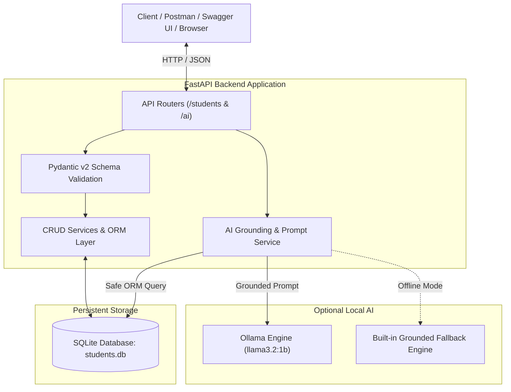

# 🎓 Students Database CRUD Application (+ Local AI Extension)
**Python Backend Development Internship Project | EWB EDU TECH PVT. LTD.**

An enterprise-ready RESTful API backend engineered with **FastAPI** and **SQLite** for managing student records. This project implements complete **Create, Read, Update, and Delete (CRUD)** operations, strict schema validation using **Pydantic v2**, robust error handling, automated testing with **Pytest**, and an **Optional Local AI Extension powered by Ollama (Llama 3.2)** with grounded record retrieval and offline fallback.

---

## 📋 Table of Contents
- [Project Overview](#-project-overview)
- [Architecture & Design](#-architecture--design)
- [Student Record Schema](#-student-record-schema)
- [Tech Stack](#-tech-stack)
- [Prerequisites & Installation](#-prerequisites--installation)
- [Running the Application](#-running-the-application)
- [Seeding Sample Data](#-seeding-sample-data)
- [API Documentation & Endpoints](#-api-documentation--endpoints)
- [Sample API Requests & Testing](#-sample-api-requests--testing)
  - [1. Create Student (POST /students)](#1-create-student-post-students)
  - [2. List & Filter Students (GET /students)](#2-list--filter-students-get-students)
  - [3. View Student by ID (GET /students/{id})](#3-view-student-by-id-get-studentsid)
  - [4. Update Student Details (PUT & PATCH)](#4-update-student-details-put--patch)
  - [5. Delete Student (DELETE /students/{id})](#5-delete-student-delete-studentsid)
  - [6. Aggregate Summary Statistics](#6-aggregate-summary-statistics)
- [Optional Bonus: Local AI with Ollama](#-optional-bonus-local-ai-with-ollama)
- [Automated Tests (Pytest)](#-automated-tests-pytest)
- [Project Structure](#-project-structure)
- [Submission & Review Checklist](#-submission--review-checklist)

---

## 🌟 Project Overview
This project was developed for the **EWB Edu Tech Internship Project Assignment**. It fulfills all core requirements:
- **Create**: Add new student profiles with auto-generated or custom student IDs and data validation.
- **Read**: List all students with pagination, sorting, search by name, and filters by course and birth dates.
- **Update**: Full (`PUT`) or partial (`PATCH`) modification of student details with duplicate collision checks.
- **Delete**: Safely delete student records and return informative confirmation payloads.
- **Persistent Storage**: SQLite with SQLAlchemy 2.0 ORM and connection pooling.
- **Security**: No raw SQL execution, sanitized queries, input constraints, and dummy data protection.
- **Optional Local AI**: Ollama-powered natural language queries strictly grounded in SQLite records.

---

## 🏛 Architecture & Design



---

## 🗃 Student Record Schema

| Field | Type | Required | Description | Constraints / Examples |
|---|---|---|---|---|
| `id` | Integer | System | Primary Key, autoincrementing | Indexed, unique |
| `student_id` | String | Auto / Custom | Unique Registration ID | Indexed, unique (e.g. `STU-1001`) |
| `name` | String | **Yes** | Full student name | 2 - 100 characters, trimmed |
| `date_of_birth` | Date | **Yes** | Date of birth | YYYY-MM-DD, must be in past (age 3–120) |
| `email` | String | **Yes** | Contact email address | Unique, RFC-compliant format |
| `phone` | String | Optional | Contact phone number | Max 25 chars (e.g. `+91-9876543210`) |
| `course` | String | Optional | Academic program / branch | E.g. `Computer Science`, `AI/ML` |
| `address` | String | Optional | Residential address / city | Max 255 chars |
| `enrollment_date`| Date | Optional | Date student joined | Defaults to current date |
| `created_at` | DateTime | System | Timestamp record created | UTC ISO-8601 |
| `updated_at` | DateTime | System | Timestamp last updated | UTC ISO-8601 |

---

## 🛠 Tech Stack
- **Language**: Python 3.10+ (Tested on Python 3.14)
- **Web Framework**: [FastAPI](https://fastapi.tiangolo.com/) (Async, OpenAPI, Swagger UI)
- **ASGI Server**: [Uvicorn](https://www.uvicorn.org/)
- **Database**: SQLite3
- **ORM**: [SQLAlchemy 2.0](https://www.sqlalchemy.org/)
- **Validation**: [Pydantic v2](https://docs.pydantic.dev/) + `email-validator`
- **AI Integration**: [Ollama](https://ollama.com/) (`llama3.2:1b`) + `httpx` async client
- **Testing**: [Pytest](https://docs.pytest.org/) + `FastAPI TestClient`

---

## ⚙ Prerequisites & Installation

### 1. Clone or Download the Project
```bash
git clone <YOUR_GITHUB_REPO_URL>
cd "Students Database CRUD"
```

### 2. Create and Activate a Virtual Environment
- **On Windows (PowerShell)**:
  ```powershell
  python -m venv venv
  .\venv\Scripts\Activate.ps1
  ```
- **On Linux / macOS**:
  ```bash
  python3 -m venv venv
  source venv/bin/activate
  ```

### 3. Install Dependencies
```bash
pip install -r requirements.txt
```

### 4. Configure Environment Variables (Optional)
A `.env.example` file is included. Copy it to `.env` if custom configurations are needed:
```bash
cp .env.example .env
```
Default configuration values:
```ini
APP_NAME="Students Database CRUD API"
APP_VERSION="1.0.0"
DEBUG=True
DATABASE_URL=sqlite:///./students.db
OLLAMA_BASE_URL=http://localhost:11434
OLLAMA_MODEL=llama3.2:1b
```

---

## 🚀 Running the Application

Start the FastAPI application with Uvicorn:
```bash
uvicorn app.main:app --reload --host 127.0.0.1 --port 8000
```

Once running, access:
- **Interactive Swagger UI**: [http://127.0.0.1:8000/docs](http://127.0.0.1:8000/docs)
- **ReDoc Documentation**: [http://127.0.0.1:8000/redoc](http://127.0.0.1:8000/redoc)
- **API Overview**: [http://127.0.0.1:8000/](http://127.0.0.1:8000/)

---

## 🌱 Seeding Sample Data

A seeding script is included to quickly populate your database with 10 realistic dummy student records:
```bash
python seed_data.py
```
Output:
```
Successfully seeded 10 dummy students. Total students in database: 10
```

---

## 📡 API Documentation & Endpoints

| Method | Endpoint | Description | Query Parameters |
|---|---|---|---|
| `GET` | `/` | API status and overview | None |
| `POST` | `/students` | Create a new student record | None |
| `GET` | `/students` | List all / filter students | `name`, `course`, `born_after`, `born_before`, `skip`, `limit`, `sort_by`, `order` |
| `GET` | `/students/stats/summary`| Aggregate statistics | None |
| `GET` | `/students/{student_id}` | View student by ID or code | Path: `id` (e.g. `1` or `STU-1001`) |
| `PUT` | `/students/{student_id}` | Full update of student details | Path: `id` or `student_id` |
| `PATCH`| `/students/{student_id}` | Partial update of student details| Path: `id` or `student_id` |
| `DELETE`| `/students/{student_id}`| Delete a student permanently | Path: `id` or `student_id` |
| `POST` | `/ai/ask` | Natural-language AI question | JSON: `{"question": "..."}` |
| `GET` | `/ai/status` | Ollama connection health check | None |

---

## 🧪 Sample API Requests & Testing

### 1. Create Student (`POST /students`)
**Request:**
```bash
curl -X POST "http://127.0.0.1:8000/students" \
     -H "Content-Type: application/json" \
     -d '{
       "name": "Ishan Verma",
       "date_of_birth": "2004-08-14",
       "email": "ishan.verma@example.edu",
       "phone": "+91-9876543220",
       "course": "Artificial Intelligence",
       "address": "Bengaluru, Karnataka",
       "enrollment_date": "2024-08-01"
     }'
```
**Response (201 Created):**
```json
{
  "id": 11,
  "student_id": "STU-1011",
  "name": "Ishan Verma",
  "date_of_birth": "2004-08-14",
  "email": "ishan.verma@example.edu",
  "phone": "+91-9876543220",
  "course": "Artificial Intelligence",
  "address": "Bengaluru, Karnataka",
  "enrollment_date": "2024-08-01",
  "created_at": "2026-10-30T07:35:10.123456Z",
  "updated_at": "2026-10-30T07:35:10.123456Z"
}
```

---

### 2. List & Filter Students (`GET /students`)

#### A. List all students (paginated):
```bash
curl -X GET "http://127.0.0.1:8000/students?skip=0&limit=5"
```

#### B. Filter by Course:
```bash
curl -X GET "http://127.0.0.1:8000/students?course=Computer%20Science"
```

#### C. Filter students born after 2005:
```bash
curl -X GET "http://127.0.0.1:8000/students?born_after=2005-01-01"
```

**Response (200 OK):**
```json
{
  "total": 5,
  "skip": 0,
  "limit": 10,
  "items": [
    {
      "id": 2,
      "student_id": "STU-1002",
      "name": "Diya Patel",
      "date_of_birth": "2005-03-22",
      "email": "diya.patel@example.edu",
      "course": "Data Analytics"
    }
  ]
}
```

---

### 3. View Student by ID (`GET /students/{student_id}`)
*Note: Accepts either integer primary key (e.g. `1`) or unique student ID (e.g. `STU-1001`).*

```bash
curl -X GET "http://127.0.0.1:8000/students/STU-1001"
```

---

### 4. Update Student Details (`PUT` & `PATCH`)

#### Patch (Partial Update):
```bash
curl -X PATCH "http://127.0.0.1:8000/students/STU-1001" \
     -H "Content-Type: application/json" \
     -d '{
       "phone": "+91-9999888877",
       "address": "Navi Mumbai, Maharashtra"
     }'
```

---

### 5. Delete Student (`DELETE /students/{student_id}`)
```bash
curl -X DELETE "http://127.0.0.1:8000/students/STU-1001"
```
**Response (200 OK):**
```json
{
  "message": "Student 'Aarav Sharma' (STU-1001) has been successfully deleted.",
  "student_id": "STU-1001",
  "id": 1
}
```

---

### 6. Aggregate Summary Statistics
```bash
curl -X GET "http://127.0.0.1:8000/students/stats/summary"
```
**Response (200 OK):**
```json
{
  "total_students": 10,
  "courses_breakdown": {
    "Computer Science": 3,
    "Data Analytics": 2,
    "Artificial Intelligence": 2,
    "Cybersecurity": 2,
    "Mechanical Engineering": 1
  }
}
```

---

## 🤖 Optional Bonus: Local AI with Ollama

The project includes a secure **Local AI Query Extension** designed according to EWB specifications:
- **Zero SQL Execution Risk**: The AI model is never allowed to execute raw SQL. Instead, backend code safely extracts records from SQLite using SQLAlchemy and feeds them as factual context into the prompt.
- **Strict Grounding**: Responses are constrained strictly to the provided database records to prevent hallucinations.
- **Fail-safe Offline Fallback**: If Ollama is not installed or offline, the API does **not** fail; a built-in deterministic grounding engine computes the answer directly from the SQLite records!

### Checking AI Status
```bash
curl -X GET "http://127.0.0.1:8000/ai/status"
```

### Asking Natural Language Questions
```bash
curl -X POST "http://127.0.0.1:8000/ai/ask" \
     -H "Content-Type: application/json" \
     -d '{
       "question": "How many students are there?"
     }'
```
**Response:**
```json
{
  "question": "How many students are there?",
  "answer": "There are currently 10 student record(s) in the database.",
  "model_used": "llama3.2:1b",
  "grounded_records_count": 10,
  "ai_available": true
}
```

#### Another Example:
```bash
curl -X POST "http://127.0.0.1:8000/ai/ask" \
     -H "Content-Type: application/json" \
     -d '{
       "question": "List students born after 2005."
     }'
```
**Response:**
```json
{
  "question": "List students born after 2005.",
  "answer": "Found 5 student(s) born after 2005: Rohan Gupta (DOB: 2006-11-05), Kabir Mehta (DOB: 2007-01-30), Vikram Singh (DOB: 2006-05-14), Arjun Kapoor (DOB: 2005-08-25), Meera Joshi (DOB: 2007-04-19).",
  "model_used": "llama3.2:1b",
  "grounded_records_count": 10,
  "ai_available": true
}
```

### How to Run Ollama Locally (Optional)
1. Download Ollama from [https://ollama.com](https://ollama.com)
2. Open terminal and run:
   ```bash
   ollama run llama3.2:1b
   ```
3. Ollama starts serving on `http://localhost:11434`. The FastAPI backend connects automatically!

---

## 🧪 Automated Tests (Pytest)

The project includes 14 unit and integration tests covering all CRUD endpoints, input validation, edge cases, and AI grounding.

To run the entire test suite:
```bash
pytest -v
```

### Test Coverage Highlights:
- ✅ `test_root_endpoint`: Verifies API welcome payload and navigation.
- ✅ `test_create_student_success`: Creates valid student, validates generated ID.
- ✅ `test_create_student_custom_id`: Supports user-defined student codes.
- ✅ `test_create_student_duplicate_email`: Rejects duplicate email with HTTP 400.
- ✅ `test_create_student_invalid_data`: Rejects malformed emails and future dates with HTTP 422.
- ✅ `test_get_and_filter_students`: Tests name search, course filter, and date ranges.
- ✅ `test_get_student_by_id_and_code`: Tests lookup by numeric PK and string ID.
- ✅ `test_update_student_put_and_patch`: Tests full and partial field updates.
- ✅ `test_delete_student`: Tests deletion and subsequent 404 confirmation.
- ✅ `test_summary_stats`: Tests student count and course aggregation.
- ✅ `test_ai_status`: Tests Ollama health check endpoint.
- ✅ `test_ai_ask_fallback_count`: Tests grounded student count calculation.
- ✅ `test_ai_ask_fallback_born_after`: Tests grounded date filtering.
- ✅ `test_ai_ask_with_mocked_ollama`: Tests full Ollama JSON request/response pipeline.

---

## 📁 Project Structure

```
Students Database CRUD/
├── app/
│   ├── __init__.py           # Package marker
│   ├── config.py             # App & Ollama settings (Pydantic BaseSettings)
│   ├── database.py           # SQLite connection & session management
│   ├── models.py             # SQLAlchemy Student ORM model
│   ├── schemas.py            # Pydantic v2 schemas for validation & responses
│   ├── crud.py               # Database CRUD logic & safe AI context retrieval
│   ├── services/
│   │   ├── __init__.py
│   │   └── ai_service.py     # Ollama API client & grounded fallback engine
│   ├── routers/
│   │   ├── __init__.py
│   │   ├── students.py       # CRUD routes: POST, GET, PUT, PATCH, DELETE
│   │   └── ai.py             # AI query route (/ai/ask) & health status (/ai/status)
│   └── main.py               # FastAPI application entrypoint & lifespan
├── tests/
│   ├── __init__.py
│   ├── conftest.py           # In-memory SQLite fixtures & TestClient
│   ├── test_crud.py          # CRUD tests (10 test cases)
│   └── test_ai.py            # AI extension tests (4 test cases)
├── seed_data.py              # Dummy dataset seeder (10 student records)
├── requirements.txt          # Production dependencies
├── .env.example              # Environment variables template
├── .gitignore                # Git exclusions (venv, SQLite db, cache)
└── README.md                 # Complete documentation
```

---

## 📋 Submission & Review Checklist

| Requirement | Implementation | Status |
|---|---|:---:|
| **Create** | `POST /students` with auto-ID or custom ID & validation | ✅ Completed |
| **Read (List & Filter)** | `GET /students` with pagination, course filter, date filters | ✅ Completed |
| **Read (Individual)** | `GET /students/{id}` supporting numeric PK & string student_id | ✅ Completed |
| **Update** | `PUT` & `PATCH` `/students/{id}` with duplicate email check | ✅ Completed |
| **Delete** | `DELETE /students/{id}` with deletion confirmation payload | ✅ Completed |
| **Tech Stack** | Python, FastAPI, SQLite, SQLAlchemy, Pydantic | ✅ Completed |
| **Student Fields** | ID, Name, DOB, Email, Phone, Course, Address, Enrollment Date | ✅ Completed |
| **Input Validation** | Pydantic v2 schemas, past birth dates, valid email formats | ✅ Completed |
| **Error Handling** | 400 Bad Request, 404 Not Found, 422 Unprocessable Entity | ✅ Completed |
| **Optional Bonus (AI)** | Ollama integration, grounded records context, zero SQL injection | ✅ Completed |
| **Offline Fallback** | Deterministic fallback grounding engine when Ollama is offline | ✅ Completed |
| **Testing** | 14 automated tests with Pytest and in-memory SQLite | ✅ Completed |
| **Documentation** | Comprehensive README with architecture, setup, and curl examples | ✅ Completed |

---

## 👨‍💻 Author & Submission
- **Project**: Students Database CRUD Application (+ Optional AI Extension)
- **Role**: Python Backend Development Intern
- **Company**: EWB EDU TECH PVT. LTD.
